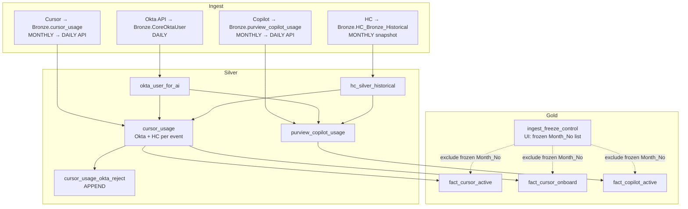
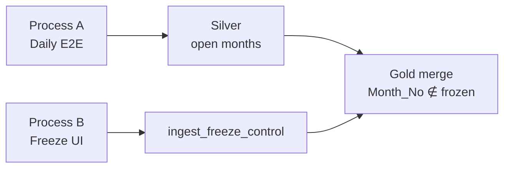
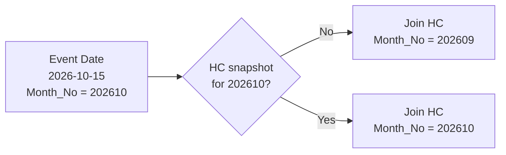
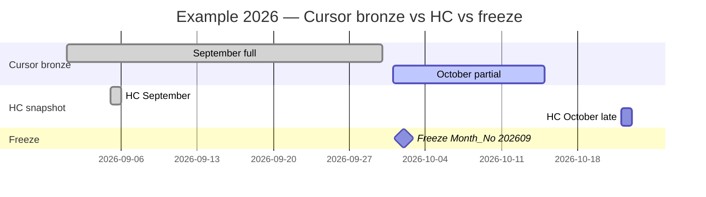
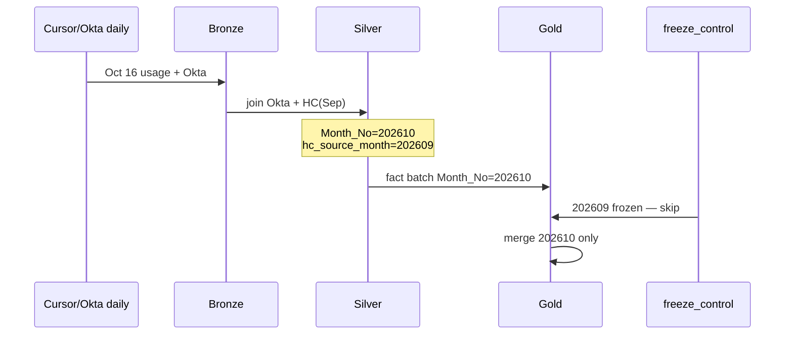
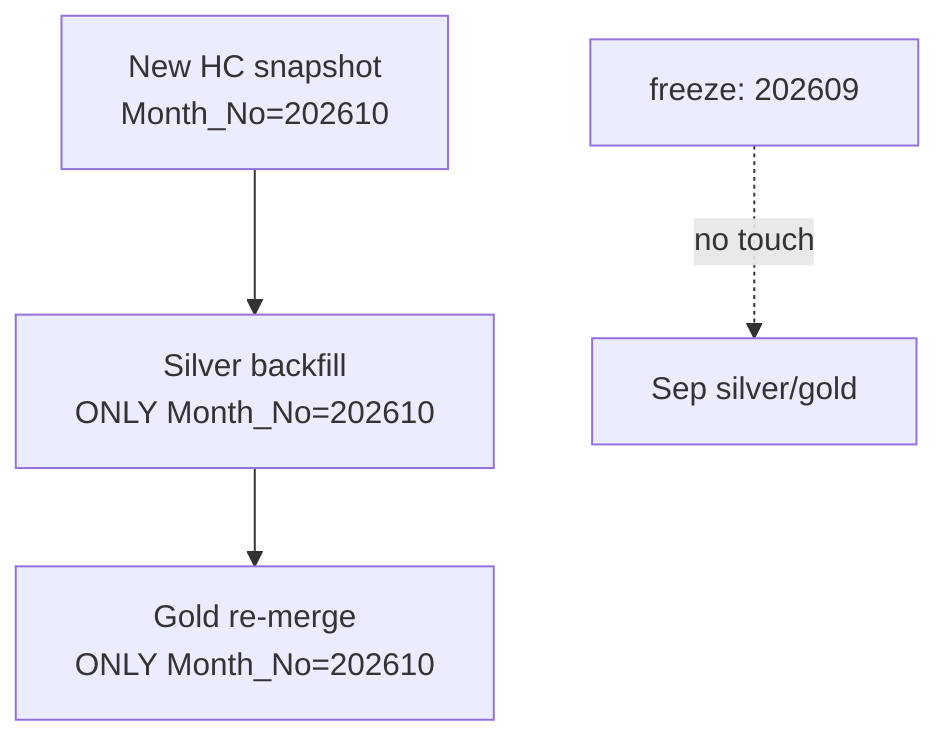

# Cursor & Copilot — Daily ingestion, HC lag, and month freeze

| Field | Value |
| --- | --- |
| **Status** | Draft — analysis / architecture (no implementation) |
| **Audience** | Data platform, CoE, Finance (month close) |
| **Products** | Cursor usage, Microsoft 365 Copilot (Purview audit path) |
| **Example period** | Sep 2026 (closed) + Oct 2026 (partial bronze, open gold) |
| **Related repo** | `CoE_transformation_framework` — Silver/Gold notebooks, `Common/transforms.py`, `Common/io.py` |

---

## 1. Purpose

Define how **daily end-to-end** processing works when:

- **Okta** lands in Bronze **daily** (API).
- **HC** is a **monthly full snapshot** (October HC may arrive after October usage starts).
- **Cursor / Copilot** are **monthly (or partial month) today**, moving to **daily API** ingestion.
- **Finance** needs to **freeze closed months** while still showing **daily activity for the current open month**, including periods where HC is still on the **prior month’s snapshot**.

---

## 2. Current vs target (summary)

| Source | Bronze cadence today | Target | Silver consumer |
| --- | --- | --- | --- |
| Okta `CoreOktaUser` | Daily (API) | Daily | `okta_user_for_ai` |
| HC `HC_Bronze_Historical` | Monthly snapshot | Monthly | `hc_silver_historical` |
| Cursor `cursor_usage` | Monthly / half-month files | Daily API | `cursor_usage` (+ Okta reject) |
| Copilot `purview_copilot_usage` | Not always loaded | Daily API | `purview_copilot_usage` |

| Gold table | Grain (key idea) | Freeze column |
| --- | --- | --- |
| `fact_cursor_active` | `CursorUsageDate` + `OktaUserId` → `Request` | `Month_No` (YYYYMM) |
| `fact_cursor_onboard` | `CursorUsageDate` + `OktaUserId` (deduped) | via `LastModification` → `Month_No` |
| `fact_copilot_active` | Activity date + Okta + interaction type | `Month_No` / activity month |

---

## 3. Target architecture

### 3.1 Layer diagram



### 3.2 Two operational processes

| Process | Name | When | Outcome |
| --- | --- | --- | --- |
| **A** | Daily E2E | Schedule (daily) | Bronze → Silver → Gold for **open** months only |
| **B** | Month freeze | On demand (UI dropdown) | Add `Month_No` to control table; block future gold merges for that month |



---

## 4. HC monthly lag (critical rule)

Usage events carry **`Month_No`** from **activity date** (e.g. Oct 15 → `202610`). HC dimensions are keyed by **`Month_No` + email** (`HCKeyEmail`).

When **October HC is not in Bronze yet**, Silver must still process October Cursor/Copilot using **September HC** (or explicit fallback rule).



| Case | Usage month | HC in Bronze | Silver HC join uses | Gold |
| --- | --- | --- | --- | --- |
| A | Oct 2026 | Sep only | Sep HC keys on Oct events | Daily merge **202610** (if not frozen) |
| B | Oct 2026 | Sep + Oct | Oct HC keys | Re-silver **202610** + re-merge gold **202610** |
| C | Sep 2026 | Sep | Sep HC | Frozen **202609** → no merge after freeze |

**Recommendation:** optional Silver column **`hc_source_month`** (YYYYMM actually used for join) for audit and support tickets.

**HC reload:** when a new monthly HC snapshot lands, run **Silver backfill only for unfrozen months** (e.g. re-run `Month_No = 202610`), then **Gold re-merge for those months only**.

---

## 5. Freeze control (proposed)

### 5.1 Control table

**Table:** `Gold.ingest_freeze_control` (or Fabric equivalent)

| Column | Type | Description |
| --- | --- | --- |
| `product` | string | `cursor` \| `copilot` \| `all` |
| `Month_No` | int | YYYYMM, e.g. `202609` |
| `frozen_at` | timestamp | When freeze was applied |
| `frozen_by` | string | User / service principal |
| `notes` | string | e.g. "Finance sign-off Sep 2026" |

**UI:** dropdown / multi-select of `Month_No` → **Insert row** (append-only history). Unfreeze = separate admin action (logged).

### 5.2 Gold merge filter (before `merge_incremental`)

```
merge_batch = fact_df WHERE Month_No NOT IN (
  SELECT Month_No FROM ingest_freeze_control WHERE product IN ('cursor','all')
)
```

**Today in repo (interim):** auto-close months already in gold with `Month_No < max(Month_No)` in batch — can remain as **safety net** until control table exists.

### 5.3 Silver backfill scope

```
process_months = {current_month} ∪ {months with new bronze/API data}
                 MINUS frozen Month_No from control table
```

Frozen months: **no Silver rewrite, no Gold merge** unless break-glass unfreeze.

---

## 6. Sep / Oct 2026 — reference timeline

**Assumption (your current state):**

- Bronze Cursor: **Sep 2026 full**, **Oct 2026 partial** (e.g. through mid-Oct).
- **Sep 2026** finance-closed → freeze `202609`.
- **Oct 2026** open for daily reporting.
- HC: **Sep snapshot available**; **Oct snapshot may arrive later**.

```text
Timeline
────────────────────────────────────────────────────────────
Cursor bronze   [======== Sep ========][==== Oct 1–15 ====]
HC bronze       [Sep snap]                    [Oct snap?]
Okta            ····· daily ·····························
Freeze control  [202609 FROZEN]              [202610 OPEN]
```



---

## 7. Scenario matrix (Sep / Oct)

| ID | `freeze_control` | HC available | Cursor bronze | Daily job Silver | Daily job Gold |
| --- | --- | --- | --- | --- | --- |
| **S1** | `{202609}` | Sep only | Oct 1–15 | Process **202610**; HC join uses **202609** | Merge **202610** only |
| **S2** | `{202609}` | Sep → Oct arrives | Oct 1–15 | **Re-silver 202610** with Oct HC | **Re-merge 202610** |
| **S3** | `{202609}` | Oct | Oct growing daily | Process **202610** only | Merge **202610** only |
| **S4** | `{202609,202610}` | Oct | Oct complete | Process **202611** when exists | Merge **202611** only |
| **S5** | `{}` | Sep | Sep + Oct | Both months in scope | Both merge (pre-freeze) |

### 7.1 Case S1 — daily Oct with Sep HC (Sep frozen)



### 7.2 Case S2 — October HC lands → recompute open month only



---

## 8. Daily E2E — step list (Process A)

| Step | Action | Notes |
| --- | --- | --- |
| 1 | Ingest Okta → Bronze | Daily API |
| 2 | Ingest Cursor/Copilot for activity date **D** (or watermark) | Daily API (future); files today |
| 3 | Refresh Silver Okta (`okta_user_for_ai`) | Current-state dimension |
| 4 | If new HC month in Bronze → refresh HC Silver | Monthly |
| 5 | Silver Cursor/Copilot for **`process_months`** (open only) | Join Okta; HC best available |
| 6 | Append Okta rejects | Unmatched users |
| 7 | Build Gold aggregates from Silver | Active + onboard / copilot active |
| 8 | **Filter out** `Month_No` in `ingest_freeze_control` | Freeze |
| 9 | `merge_incremental` on surrogate keys | Idempotent daily |

---

## 9. Month freeze — step list (Process B)

| Step | Action |
| --- | --- |
| 1 | Finance / CoE selects **Month_No** in UI (e.g. `202609`) |
| 2 | Insert into `ingest_freeze_control` |
| 3 | Optional: one **final** Silver + Gold run for that month before insert (if not already done) |
| 4 | All later daily runs **exclude** that month from Gold merge (and Silver backfill) |

---

## 10. Column reference (existing pipeline)

### 10.1 Cursor Silver (`cursor_usage`)

| Column | Role |
| --- | --- |
| `CursorUsageDate` | Event date |
| `CursorUsageMonthNo` | YYYYMM from usage date |
| `CursorUsageUser` | Join to Okta email |
| `OktaUserId`, `OktaUserEmail`, … | From Okta |
| `HCKeyEmail`, `HCBusinessUnit`, … | From HC (month-dependent) |
| `RecordSurrogateKey` | Silver merge key |

### 10.2 Cursor Gold active

| Column | Role |
| --- | --- |
| `Month_No` | From `CursorUsageMonthNo` |
| `LastModification` | Activity date |
| `userId` | `OktaUserId` |
| `Request` | Daily activity count |
| `RecordSurrogateKey` | Gold merge key |

### 10.3 Copilot Silver / Gold (align freeze the same way)

| Silver | Gold |
| --- | --- |
| `purview_copilot_usage_date` | Activity date |
| Month from date | `Month_No` |
| `okta_user_id` | `userId` |

---

## 11. Cursor vs Copilot parity

| Capability | Cursor | Copilot |
| --- | --- | --- |
| Daily bronze append | Target | Target |
| Okta reject quarantine | `cursor_usage_okta_reject` | Recommend `purview_copilot_okta_reject` |
| Gold month freeze filter | Active + onboard | Apply to `fact_copilot_active` |
| HC lag handling | Same join/fallback | Same |
| Shared freeze UI | `product = all` or per product | Same control table |

---

## 12. Interim vs target (repo today)

| Topic | Today (sandbox / PR) | Target |
| --- | --- | --- |
| Sandbox tables | `*_abdellah` suffix | Prod names after validation |
| Freeze | Auto: gold months `< batch max Month_No` | **+** `ingest_freeze_control` UI |
| HC lag | Implicit in notebook join | Document + optional `hc_source_month` |
| Copilot freeze | Not yet | Same as Cursor |

---

## 13. Open decisions

| # | Question | Options |
| --- | --- | --- |
| 1 | One freeze list or per product? | `all` vs `cursor` / `copilot` rows |
| 2 | Allow **unfreeze** and who approves? | Break-glass + audit |
| 3 | Tag provisional HC on Silver? | `hc_source_month` YYYYMM |
| 4 | Late corrections after freeze? | Adjustment fact table vs reopen month |
| 5 | API idempotency key | Vendor id vs hash of (user, date, model, tokens…) |

---

## 14. Paste into Confluence

1. **Confluence Cloud:** create page → paste this Markdown (Cloud converts headings/tables/code).
2. **Mermaid diagrams:** insert **Mermaid** macro / draw.io, or export diagrams from [mermaid.live](https://mermaid.live).
3. **Info panel (wiki markup alternative):**

```
{info:title=Summary}
Daily E2E for open months only. HC monthly lag uses prior month until new snapshot. Freeze via ingest_freeze_control + UI. Sep 2026 frozen; Oct 2026 daily with Sep HC until Oct HC reload.
{info}
```

---

## 15. Appendix — ASCII one-pager (Oct half + Sep frozen)

```text
┌─────────────────────────────────────────────────────────────┐
│ ingest_freeze_control:  Month_No ∈ { 202609 }               │
└─────────────────────────────────────────────────────────────┘
         │ blocks Silver backfill + Gold merge for 202609

Bronze Cursor     [======= Sep 2026 =======][= Oct 1–15 =]
Bronze HC         [ Sep snapshot ]     ( Oct snapshot later )
Okta API          ············· daily ·····················

Each daily run:
  Silver scope     →  Month_No = 202610 only
  HC join          →  202609 until Oct HC exists
  Gold merge       →  Month_No = 202610 only

When Oct HC arrives:
  Re-Silver        →  202610 only
  Re-Gold merge    →  202610 only   (202609 stays frozen)
```

---

*Document generated for CoE / Fabric medallion — analysis only; implementation tracked separately in GitHub.*
